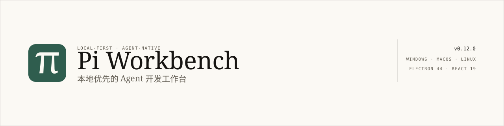

<p align="center">
  <picture>
    <source media="(prefers-color-scheme: dark)" srcset="docs/assets/banner-dark.svg">
    
  </picture>
</p>

# Pi Workbench

A local-first desktop workbench where a real coding agent sits next to your editor — it reads, writes, edits and runs commands on your actual files, and the permission boundary is yours to set.

[](https://github.com/T-Chen-CN/pi-workbench/actions/workflows/ci.yml)
[](https://github.com/T-Chen-CN/pi-workbench/releases/latest)
[](LICENSE)
[](#download)
[](package.json)

[简体中文](README.md) · **English** · [Download](#download) · [Docs](docs/README.md)

---

## Contents

1. [Highlights](#highlights)
2. [Download](#download)
3. [Getting started](#getting-started)
4. [Configuration](#configuration)
5. [Project status](#project-status)
6. [How it works](#how-it-works)
7. [Project structure](#project-structure)
8. [Contributing](#contributing)
9. [Docs](#docs)
10. [License](#license)

---

## Highlights

### The agent changes files — and only the ones you allow

Not "please don't touch anything" in a prompt, but a runtime boundary. The agent runs inside the main process, every tool call is checked against the session mode, anything that needs a decision raises an approval card, and a timeout counts as a refusal.

- **Four session modes**: read-only / plan / ask / full. Read-only denies instead of asking — there is no "I clicked allow and it wrote to disk" failure mode.
- **Plan mode makes it show its work first**: only read-only tools are enabled, and it must submit a plan card (steps, files at risk, risks). Approving flips the session into execution mode atomically and the plan becomes a live checklist.
- **Approvals cover four kinds of action** (read / write / command / other): allow once, for this session, always, or deny. Silence times out as a denial, it never just hangs.

### One session, one worktree — parallel tasks stop colliding

Switching tasks no longer means stash and copy. Bind a session to a Git worktree, every turn lands there, and the history is still there when you switch back.

- **The binding is on disk**: `.pi-workbench/session-git.json` remembers session ↔ worktree; switching takes effect only at turn boundaries, never mid-turn.
- **Dependencies install themselves**: the lockfile is detected (pnpm / bun / yarn / npm / uv), installs run serially in the background with a hard timeout, results are cached by hash — unchanged lockfiles are reused.
- **The Git panel covers all branches**: classified refs, merge markers, commit detail with per-file diffs, plus PR and CI status for the current branch.

### It actually opens your PDF, Word and Excel files

No MCP server, no "convert to Markdown first". The same `read` tool sniffs the format by magic bytes and hands back the actual content.

- **Six formats**: `.pdf` / `.docx` / `.xlsx` / `.pptx` / `.odt` / `.epub`, parsed with zero added dependencies.
- **Scans are not dropped**: PDFs without a text layer are rendered to images and go through the vision channel; legacy `.doc` / `.xls` / `.ppt` are not guessed at — you get a "save as" pointer instead.
- **Readable in the editor too**: Markdown / HTML rendering, image, audio and video preview, a self-drawn pdf.js reader (page navigation, 50%–400% zoom), and read-only Office previews.

### Every change is reviewable, and revertible one file at a time

The agent does not just say "done". Every file it touched in that turn shows up in the conversation — review the diff, or throw it away.

- **Inline change cards**: one per file, open the diff, revert one file or all of them; files with unsaved edits are refused rather than silently overwritten.
- **The process is visible**: thinking and tool calls render as a timeline with durations, arguments and result previews; `write` / `edit` jump straight to the diff.
- **History is not lost**: history and export read the session record (entry chain), so pre-compaction messages survive and the compaction marker lands on the turn where it happened.
- **You can change your mind**: queue or steer mid-turn, regenerate and switch branches, edit-and-resend a user message.

### Close the window; it keeps working

This is not an IDE plugin but a standalone workbench: closing the window only parks it in the tray, while sessions, file watchers and update checks keep running.

- **Workspaces stay resident**: switching tabs only toggles visibility — editors, diffs, terminal and agent sessions are all kept, not torn down.
- **Panels detach**: pull the file tree, Git view, chat or terminal into a native window; detached windows stay visible when the main window hides to the tray, sync live across windows, and dock back on restart while keeping your panel widths.
- **Context has a meter**: token usage and cost sit above the composer, with an optional budget cap; only 80% / 95% change colour.

### Local-first: your data stays on your machine

| Location                     | Contents                                                                               |
| ---------------------------- | -------------------------------------------------------------------------------------- |
| `{appDir}/config/`           | `settings.json`, `providers.json`, `credentials.json` (keys encrypted), `web-search.json`, `mcp.json`, `mcp-trust.json` |
| `{appDir}/data/`             | `models.json`, session records, `workspaces.db`                                        |
| `{appDir}/cache/`            | temp files, downloaded update packages                                                 |
| `{appDir}/logs/`             | `main.log`, `agent.log` (rotated at 5MB)                                               |
| `{workspace}/.pi-workbench/` | editor tabs, chat tabs, session extras, worktree binding, terminal logs, plugin & project MCP config |

- API keys, web-search keys and MCP secrets are encrypted with Electron `safeStorage` as `enc:<base64>`; plaintext never reaches disk, logs or the workspace. Project-level MCP configs require explicit user approval pinned by SHA-256 fingerprint before connecting.
- The renderer is sandboxed with no Node access; the Pi Agent and workspace plugins run in an isolated `utilityProcess`; every IPC channel validates its sender; file operations are confined to trusted workspaces plus `{appDir}/cache/`.
- No telemetry, no account, fully offline-capable; web search and MCP servers are optional.
- Standard builds use a strict two-directory layout separating the install folder from a single data directory (`%APPDATA%\pi-workbench` on Windows, `~/Library/Application Support/pi-workbench` on macOS, `~/.config/pi-workbench` on Linux); the Windows Portable `.zip` keeps data inside the extracted folder.

> **Everything else** (useful, but not the selling point): multi-tab Monaco editing with native side-by-side Diff, 2s debounced auto-save, file tree operations with live refresh, an xterm.js + node-pty terminal, global and project MCP servers (`stdio` / Streamable HTTP / SSE), command palette and workspace plugins, Paper / Ink themes, Chinese / English UI, crash-recovered drafts, auto-update.

---

## Download

Grab the installer for your platform from the [latest release](https://github.com/T-Chen-CN/pi-workbench/releases/latest).

| Platform | Asset                                      | Notes                                                                                                    |
| -------- | ------------------------------------------ | -------------------------------------------------------------------------------------------------------- |
| Windows  | `Pi-Workbench-Setup-<version>.exe`         | NSIS installer (supports differential auto-updates); data lives in `%APPDATA%\pi-workbench`              |
| Windows  | `Pi-Workbench-Portable-<version>-win-x64.zip` | Portable build; unzip and run with data inside the extracted folder (guided manual download on update) |
| macOS    | `Pi-Workbench-<version>-universal.dmg`     | Universal binary (Apple Silicon + Intel)                                                                 |
| Linux    | `Pi-Workbench-<version>.AppImage`          | `chmod +x` and run                                                                                       |

Builds are produced by GitHub Actions on a version tag. They are **not code-signed or notarized**, so the first launch triggers Windows SmartScreen or macOS Gatekeeper — confirm once.

Updates: a silent check runs 12 seconds after launch; Windows / Linux download in the background but **never install on their own** (you confirm), macOS only checks and links to the download. Upgrading replaces program files and leaves the data directories untouched.

---

## Getting started

### A. Install and run

Install, open, fill in the API settings once (next section). No Node, no extra runtime.

### B. From source

```bash
npm install
npm run dev        # builds the bridge + main process, then starts Vite + Electron
```

**Node ≥ 24** is required (Electron 44 bundles Node 24, and workspace history uses `node:sqlite`). The `bash` tool needs a real bash on the system (Git for Windows on Windows).

UI and agent debugging only (browser mode — files / Git / terminal are mocked):

```bash
npm run web:dev
```

### C. Package it yourself

```bash
npm run package:win
npm run package:mac
npm run package:linux
```

Artifacts land in `release/`. Building, signing, auto-update and troubleshooting: [BUILD_AND_PACKAGE](docs/guides/BUILD_AND_PACKAGE.md).

### Quality gates

```bash
npm run type-check
npm test           # 2,090+ Vitest cases
npm run lint
npm run build
npm run test:e2e:smoke
```

---

## Configuration

Open **Settings → Providers** on first run and complete three steps:

1. **Pick a provider** — 8 built-in presets: OpenAI, Anthropic, Google, xAI, DeepSeek, Xiaomi MiMo, Xiaomi (Token Plan), and OpenAI Codex. Models and protocols come from the Pi catalog, so no Base URL is needed.
2. **Sign in** — enter an API key, or sign in with OAuth (device code / browser callback; the UI displays the link and code). Credentials are encrypted via `safeStorage` as `enc:<base64>` in `config/credentials.json` — never in environment variables or logs.
3. **Choose a model** — any model in the catalog is selectable; context window and max output tokens can be **lowered** per model and take effect on the next turn.

**Web search** (optional): pick one of ten providers; the key is encrypted into `config/web-search.json`.
**MCP servers** (optional): configure global `stdio` / Streamable HTTP / SSE servers in **Settings → MCP Servers** (secrets encrypted in `config/mcp.json`), or explicitly approve workspace `.pi-workbench/mcp.json` / `.mcp.json` files (SHA-256 fingerprint pinned); when paired with a self-hosted cloud service, cloud MCP servers can also be managed from both the desktop app and web console.

---

## Project status

| Item            | State                                                                                                                                                         |
| --------------- | ------------------------------------------------------------------------------------------------------------------------------------------------------------- |
| Current version | `0.12.2` (2026-11-28)                                                                                                                                         |
| Releases        | Installers, Windows Portable `.zip` and `latest*.yml` produced by CI on version tags                                                                          |
| Phases          | Local Agent workbench & Pi-kernel Cloud Agent live; `utilityProcess` isolation, native multi-window detach, unified MCP, and strict two-folder layout shipped |
| Quality         | 9-tsconfig type-check + `eslint --max-warnings 0` + 2,090+ Vitest cases + full `build` / `build:cloud` + Playwright Electron smoke E2E                        |
| Stack           | Electron 44 · React 19 · TypeScript 5.9 · Zustand 5 · Monaco 0.57 · Zod 4 · i18next · `@earendil-works/pi-coding-agent` 1.3                                   |
| Known limits    | Not signed or notarized; legacy Office formats are not parsed; no OCR for scans; Linux tray degrades to minimize; manual macOS / Linux & live-credential checks pending |

**Next up**: live-credential manual acceptance for the 8 provider presets, manual macOS / Linux acceptance, cloud OAuth login, and evaluating managed worktree placement. Current state is in [STATUS](docs/progress/STATUS.md); tasks and parked items in [BACKLOG](docs/progress/BACKLOG.md).

---

## How it works

```
Renderer (sandboxed, no Node; native multi-window support)
  React + Zustand 5 + Monaco
  window.electronAPI  ←  contextBridge  ←  preload.cjs
        │  IPC: every channel goes through handleIpc (sender + Zod validation, fail-closed)
Main process (Electron 44 / Node 24)
  fs · dialogs · safeStorage · chokidar · PTY · updater · cloud runner
        ├── worker_threads: PDF / OOXML parsing, repo-map scanning
        └── utilityProcess (direct MessagePort streaming, crash recovery)
              AgentManager (pi-coding-agent) + MCP Client + workspace plugins
              read / write / edit / bash and MCP tools run inside session permission boundaries
```

The Pi Agent and workspace plugins run isolated in an Electron `utilityProcess` streaming over a direct `MessagePort` (never behind a local HTTP service), keeping permission enforcement, approval timeouts and worktree binding deterministic; CPU-heavy non-agent parsing (PDF / Office extraction, repo-map scanning) is offloaded to `worker_threads` to keep the UI responsive.

---

## Project structure

```
electron/           main process: typed IPC contract & Zod validation, agent host, MCP store, git, worker parsing, terminal, updater, cloud runner
src/                renderer: components (10 domains), store (Zustand 5), hooks, api (IPC wrappers), theme
pi-bridge/          Agent bridge: session projection, tool/approval policy, unified MCP host, titles and cloud protocol contracts
packages/ui/        shared Paper & Ink UI primitives and streaming renderers for desktop and cloud web
packages/i18n/      shared typed i18next Chinese/English catalogs and error localization
packages/cloud-ui/  shared cloud UI between desktop and cloud web (task cards, memory, MCP manager, WS frame reducer)
apps/cloud/         cloud agent service (Node 24 node:sqlite + dual WS + web console)
tests/              Vitest suites (grouped by domain: agent / cloud / electron / git / ui / utils) + Playwright Electron smoke
docs/               project documentation
examples/           plugin examples (git-tools)
```

Process model, data flow and the IPC channel table: [PROJECT_STRUCTURE](docs/architecture/PROJECT_STRUCTURE.md).

---

## Contributing

- **Report a bug**: include reproduction steps and the relevant slice of `logs/main.log` / `logs/agent.log` (keys never reach the logs).
- **Send a PR**: run `npm run type-check` / `npm test` / `npm run lint` / `npm run build` first; UI changes must also pass `tests/ui/design-system.test.ts`.
- **Translate**: UI strings live in `packages/i18n/`; keep Chinese and English in sync.
- **Write a plugin**: start from [examples/plugins/git-tools](examples/plugins/git-tools); commands and hooks are documented in [PROJECT_STRUCTURE](docs/architecture/PROJECT_STRUCTURE.md).

Rules for agents working on this repo: [AGENTS.md](AGENTS.md). Copy guidelines: [PUBLIC_COPY](docs/guides/PUBLIC_COPY.md).

---

## Docs

- [Docs index](docs/README.md) — everything, indexed by task
- [Project plan](docs/PROJECT_PLAN.md) — positioning, process model, technical decisions
- [Project structure](docs/architecture/PROJECT_STRUCTURE.md) — code layout, data flow, IPC channels
- [Design system](docs/design/DESIGN_SYSTEM.md) — the single source of truth for color, type, spacing, components
- [Agent runtime](docs/agent/agent-runtime.md) — sessions, permissions, plans, tool policy, compaction, export
- [Git and worktrees](docs/agent/git-and-worktrees.md) — worktree binding, Git view, GitHub integration
- [Build & packaging](docs/guides/BUILD_AND_PACKAGE.md) — building, releasing, auto-update, troubleshooting
- [Status](docs/progress/STATUS.md) — what is done, per phase

---

## License

MIT — see [LICENSE](LICENSE). Third-party notices: [THIRD_PARTY_NOTICES.md](THIRD_PARTY_NOTICES.md).

Chinese README: [README.md](README.md)
