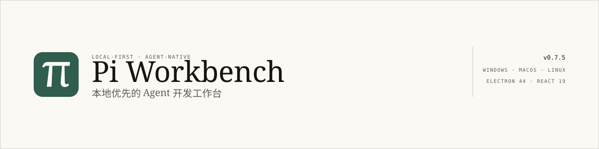

<p align="center">
  <picture>
    <source media="(prefers-color-scheme: dark)" srcset="docs/assets/banner-dark.svg">
    
  </picture>
</p>

# Pi Workbench

A local-first desktop workbench where a real coding agent sits next to your editor — it reads, writes, edits and runs commands on your actual files, inside a permission mode you choose.

[](https://github.com/T-Chen-CN/pi-workbench/actions/workflows/ci.yml)
[](https://github.com/T-Chen-CN/pi-workbench/releases/latest)
[](LICENSE)
[](#download)
[](package.json)

[简体中文](README.md) · **English** · [Download](#download) · [Docs](docs/README.md)

---

## Contents

1. [Highlights](#highlights)
2. [Download](#download)
3. [Getting started](#getting-started)
4. [Configuration](#configuration)
5. [Project status](#project-status)
6. [How it works](#how-it-works)
7. [Project structure](#project-structure)
8. [Contributing](#contributing)
9. [Docs](#docs)
10. [License](#license)

---

## Highlights

### The agent: finish the job, not hand you a snippet

The agent is a main-process runtime, not a child process or a side-car HTTP service — which is what makes permission enforcement and approval timeouts mean anything. It works on the real files of the workspace, and every tool call has to pass the session mode.

<!-- screenshot slot: docs/assets/shot-agent.png (Ink theme, expanded tool trace + inline change card + approval card) -->

- **Four permission modes per session**: read-only / plan / ask / full. Anything that needs a decision raises an approval card (allow once / this session / always / deny); unresolved approvals fail closed on timeout.
- **Plan mode**: only read-only tools are enabled, and the agent must submit a plan card (steps, files at risk, risks). Approving flips the session into execution mode and the plan becomes a live checklist.
- **Visible process**: thinking and tool calls render as an ordered timeline with durations, arguments and result previews; `write` / `edit` open the matching diff.
- **A conversation that behaves like a terminal**: queue or steer while a turn is running, regenerate and switch branches, edit-and-resend, and a marker at the exact turn compaction happened.

### Documents: one `read` to rule them all

No second read tool. PDF and Office are covered by the built-in `read`, so the model only needs to know that `read` reads everything.

<!-- screenshot slot: docs/assets/shot-docs.png (Paper theme, Office / PDF read-only preview + attachment chips) -->

- **Six formats**: `.pdf` / `.docx` / `.xlsx` / `.pptx` / `.odt` / `.epub` are detected by magic bytes (not extension) and parsed with zero added dependencies.
- **Scans go through the vision channel**: PDFs without a text layer are rendered to images; legacy `.doc` / `.xls` / `.ppt` are not guessed at — they return a "save as" pointer instead.
- **Reading views in the editor**: Markdown / HTML render (Markdown supports block-level in-place editing), images / audio / video preview over a local protocol, and a self-drawn pdf.js PDF reader with page navigation and 50%–400% zoom.
- **Office read-only previews**: Word body, table grid, slide cards and EPUB chapters each get their own layout.

### Git and worktrees: parallel work that does not collide

A session is bound to a worktree, and every turn lands there — switching tasks no longer means moving files around.

<!-- screenshot slot: docs/assets/shot-worktree.png (Ink theme, worktree chip + commit graph) -->

- **All-branch commit graph**: classified refs, merge markers, commit detail with per-file diffs.
- **Session-bound worktrees**: switching takes effect only at turn boundaries; the binding lives in `.pi-workbench/session-git.json`.
- **Worktree dependencies install themselves**: the lockfile is detected (pnpm / bun / yarn / npm / uv), installs are serialized in the background with a hard timeout, and results are cached by lockfile hash.
- **GitHub integration**: device-flow sign-in (PAT fallback) with PR and CI status for the current branch.

### The workbench: panels detach, closing keeps it running

Multiple workspaces, detachable panels, a tray-resident window — none of this is decoration; it is what lets the agent keep working while you do something else.

<!-- screenshot slot: docs/assets/shot-panel.png (Ink theme, main window + a panel in its own window) -->

- **Persistent workspaces**: switching tabs only toggles visibility; each workspace keeps its editors, diffs, terminal and agent sessions.
- **Detachable panels**: pull the file tree, Git view, chat or terminal into its own window. Panels share one store, so the terminal keeps its PTY and 200KB scrollback.
- **Terminal and plugins**: xterm.js + node-pty, output attachable to the agent as context; command palette plus workspace plugins (commands / hooks / hot reload).
- **Tray-resident**: closing the window keeps sessions, file watchers and update checks running; quit from the tray menu.

### Local-first: your data stays on your machine

| Location                     | Contents                                                                               |
| ---------------------------- | -------------------------------------------------------------------------------------- |
| `{appDir}/config/`           | `settings.json`, `api-config.json`, `web-search.json` (keys encrypted)                 |
| `{appDir}/data/`             | `models.json`, session records, `workspaces.db`                                        |
| `{appDir}/cache/`            | temp files, downloaded update packages                                                 |
| `{appDir}/logs/`             | `main.log`, `agent.log` (rotated at 5MB)                                               |
| `{workspace}/.pi-workbench/` | editor tabs, chat tabs, session extras, worktree binding, terminal logs, plugin config |

- API keys are encrypted with Electron `safeStorage` as `enc:<base64>`; plaintext never reaches disk, logs or the workspace.
- The renderer is sandboxed with no Node access; every IPC channel validates its sender; file operations are confined to trusted workspaces plus `{appDir}/cache/`.
- No telemetry, no account, fully offline-capable; web search is optional.
- On macOS the app bundle is read-only, so data lives in `~/Library/Application Support/pi-workbench`.

---

## Download

Grab the installer for your platform from the [latest release](https://github.com/T-Chen-CN/pi-workbench/releases/latest).

| Platform | Asset                                  | Notes                                                                                |
| -------- | -------------------------------------- | ------------------------------------------------------------------------------------ |
| Windows  | `Pi-Workbench-Setup-<version>.exe`     | NSIS installer; upgrades replace program files and keep `config/ data/ logs/ cache/` |
| macOS    | `Pi-Workbench-<version>-universal.dmg` | Universal binary (Apple Silicon + Intel)                                             |
| Linux    | `Pi-Workbench-<version>.AppImage`      | `chmod +x` and run                                                                   |

Builds are produced by GitHub Actions on a version tag. They are **not code-signed or notarized**, so the first launch triggers Windows SmartScreen or macOS Gatekeeper — confirm once.

Updates: a silent check runs 12 seconds after launch; Windows / Linux download in the background but **never install on their own** (you confirm), macOS only checks and links to the download. Upgrading replaces program files and leaves the data directories untouched.

---

## Getting started

### A. Install and run

Install, open, fill in the API settings once (next section). No Node, no extra runtime.

### B. From source

```bash
npm install
npm run dev        # builds the bridge + main process, then starts Vite + Electron
```

**Node ≥ 24** is required (Electron 44 bundles Node 24, and workspace history uses `node:sqlite`). The `bash` tool needs a real bash on the system (Git for Windows on Windows).

UI and agent debugging only (browser mode — files / Git / terminal are mocked):

```bash
npm run web:dev
```

### C. Package it yourself

```bash
npm run package:win
npm run package:mac
npm run package:linux
```

Artifacts land in `release/`. Building, signing, auto-update and troubleshooting: [BUILD_AND_PACKAGE](docs/guides/BUILD_AND_PACKAGE.md).

### Quality gates

```bash
npm run type-check
npm test           # 1,200+ Vitest cases
npm run lint
npm run build
```

---

## Configuration

Open **Settings** on first run and complete five steps:

1. **Provider** — Anthropic, OpenAI, or any OpenAI-compatible endpoint (DeepSeek, a gateway, a local server).
2. **API URL** — base endpoint, e.g. `https://api.deepseek.com/v1`.
3. **API key** — stored as `enc:<base64>` in `config/api-config.json` via `safeStorage`; the agent reads it from an environment variable at runtime.
4. **Fetch available models** — pull the provider's real model list, then set the context window (64K / 128K / 256K / 1M) and image capability per model.
5. **Web search** (optional) — pick one of ten providers; the key is encrypted into `config/web-search.json`.

---

## Project status

| Item            | State                                                                                                                                                         |
| --------------- | ------------------------------------------------------------------------------------------------------------------------------------------------------------- |
| Current version | `0.7.5` (2026-10-31)                                                                                                                                          |
| Releases        | 12 GitHub releases; installers and `latest*.yml` produced by CI on tags                                                                                       |
| Phases          | Phase 0–4 done · Phase 5 (Fleet background jobs) removed 2026-10-24 · Phase 6 ongoing                                                                         |
| Quality         | type-check + lint + 1,200+ Vitest cases + full build; CI also runs a Windows packaging smoke test                                                             |
| Stack           | Electron 44 · React 19 · TypeScript 5.9 · Monaco 0.57 · `@earendil-works/pi-coding-agent` 1.3                                                                 |
| Known limits    | Not signed or notarized; legacy Office formats are not parsed; no OCR for scans; Linux tray degrades to minimize; manual platform acceptance is still pending |

**In progress**: a top-level agent that orchestrates across workspaces (dispatching sub-sessions, delegated grants, headless workspaces) is still at the requirements-draft stage — see [TOP_LEVEL_AGENT_BRIEF](docs/requirements/TOP_LEVEL_AGENT_BRIEF.md). Phase-by-phase history is in [STATUS](docs/progress/STATUS.md); parked items in [BACKLOG](docs/progress/BACKLOG.md).

---

## How it works

```
Renderer (sandboxed, no Node)
  React + Zustand + Monaco
  window.electronAPI  ←  contextBridge  ←  preload
        │  IPC: every channel goes through handleIpc (sender-validated, fail-closed)
Main process (Electron 44 / Node 24)
  fs · dialogs · safeStorage · watchers · PTY · PDF / OOXML extraction
  AgentManager (pi-coding-agent) ──HTTP──> model provider
  read / write / edit / bash operate on the workspace directly
```

The agent never runs in a child process, a worker or an HTTP service — it is a main-process runtime. That is what makes permission enforcement, approval timeouts and worktree binding possible.

---

## Project structure

```
electron/     main process: IPC domains, agent registry, git, document extraction, terminal, updater
src/          renderer: components, stores, hooks, api (IPC wrappers), i18n, theme
pi-bridge/    AgentManager: sessions, tool policy and titles on top of pi-coding-agent
tests/        Vitest suites (flat, one file per source file)
docs/         project documentation
examples/     plugin examples (git-tools)
```

Process model, data flow and the IPC channel table: [PROJECT_STRUCTURE](docs/architecture/PROJECT_STRUCTURE.md).

---

## Contributing

- **Report a bug**: include reproduction steps and the relevant slice of `logs/main.log` / `logs/agent.log` (keys never reach the logs).
- **Send a PR**: run `npm run type-check` / `npm test` / `npm run lint` / `npm run build` first; UI changes must also pass `tests/design-system.test.ts`.
- **Translate**: UI strings live in `src/i18n/`; keep Chinese and English in sync.
- **Write a plugin**: start from [examples/plugins/git-tools](examples/plugins/git-tools); commands and hooks are documented in [PROJECT_STRUCTURE](docs/architecture/PROJECT_STRUCTURE.md).

Rules for agents working on this repo: [AGENTS.md](AGENTS.md). Copy guidelines: [PUBLIC_COPY](docs/guides/PUBLIC_COPY.md).

---

## Docs

- [Docs index](docs/README.md) — everything, indexed by task
- [Project plan](docs/PROJECT_PLAN.md) — positioning, process model, technical decisions
- [Project structure](docs/architecture/PROJECT_STRUCTURE.md) — code layout, data flow, IPC channels
- [Design system](docs/design/DESIGN_SYSTEM.md) — the single source of truth for color, type, spacing, components
- [Agent runtime](docs/agent/agent-runtime.md) — sessions, permissions, plans, tool policy, compaction, export
- [Git and worktrees](docs/agent/git-and-worktrees.md) — worktree binding, Git view, GitHub integration
- [Build & packaging](docs/guides/BUILD_AND_PACKAGE.md) — building, releasing, auto-update, troubleshooting
- [Status](docs/progress/STATUS.md) — what is done, per phase

---

## License

MIT — see [LICENSE](LICENSE). Third-party notices: [THIRD_PARTY_NOTICES.md](THIRD_PARTY_NOTICES.md).

Chinese README: [README.md](README.md)
