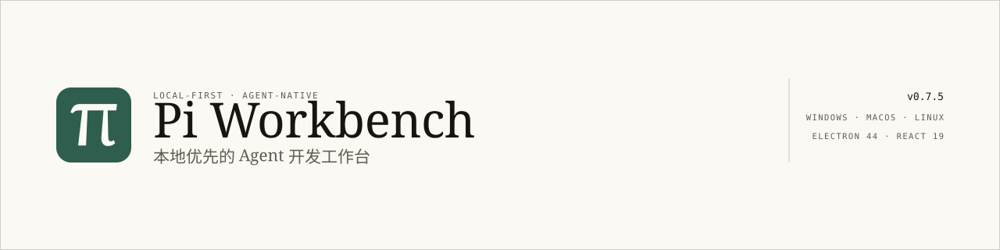

<p align="center">
  <picture>
    <source media="(prefers-color-scheme: dark)" srcset="docs/assets/banner-dark.svg">
    
  </picture>
</p>

# Pi Workbench

本地优先的桌面开发工作台：真实的编码 Agent 就在编辑器旁边，读写你的文件、执行命令，权限边界由你定。

[](https://github.com/T-Chen-CN/pi-workbench/actions/workflows/ci.yml)
[](https://github.com/T-Chen-CN/pi-workbench/releases/latest)
[](LICENSE)
[](#下载)
[](package.json)

**简体中文** · [English](README.en.md) · [下载](#下载) · [文档](docs/README.md)

---

## 目录

1. [特性一览](#特性一览)
2. [下载](#下载)
3. [开始使用](#开始使用)
4. [配置](#配置)
5. [开发情况](#开发情况)
6. [工作原理](#工作原理)
7. [项目结构](#项目结构)
8. [参与贡献](#参与贡献)
9. [文档](#文档)
10. [许可证](#许可证)

---

## 特性一览

### 改文件的是 Agent，能不能改由你定

不是「在提示词里请它别乱改」，而是运行时硬边界。Agent 跑在主进程内，每次工具调用都按会话模式校验，需要决策的弹审批卡，超时一律拒绝。

- **四档会话权限**：只读 / 计划 / 询问 / 完全。只读模式用 `deny` 而不是 `ask`，不存在「点了允许就写进磁盘」的意外。
- **计划模式先交底再动手**：只放行只读工具，必须先产出计划卡（步骤、涉及文件、风险）；批准后会话原子切到执行模式，计划变成可勾选进度。
- **审批覆盖四类动作**（读 / 改 / 命令 / 其他）：允许一次、本会话、始终或拒绝。静默超时按拒绝处理，不会挂在那里等。

### 一个会话一条工作树，几个任务同时开也不会撞

换任务不再靠 stash 和搬文件。会话绑到 Git 工作树，之后每一轮都落在那里，切回来历史还在。

- **绑定关系落盘**：`.pi-workbench/session-git.json` 记住会话 ↔ 工作树，切换只在轮次边界生效，不会半路换目录。
- **依赖自动装**：按 lockfile 识别 pnpm / bun / yarn / npm / uv，后台串行安装、硬超时，结果按哈希缓存；没改 lockfile 就直接复用。
- **Git 面板看全部分支**：ref 分类着色、合并标记、提交详情与逐文件 Diff，并显示当前分支的 PR 与 CI 状态。

### 你的 PDF、Word、Excel 它真的能读

不用装 MCP、不用先转 Markdown。同一个 `read` 工具按魔数认格式，直接把正文交出来。

- **六种格式**：`.pdf` / `.docx` / `.xlsx` / `.pptx` / `.odt` / `.epub`，零新增依赖解析。
- **扫描件也不放弃**：没有文本层的 PDF 渲染成图片走视觉通道；旧格式 `.doc` / `.xls` / `.ppt` 不瞎猜，直接给「另存为」指引。
- **编辑器里同样能看**：Markdown / HTML 渲染、图片音频视频预览、自绘 pdf.js 阅读器（翻页、50%–400% 缩放），Office 另有只读预览。

### 每一处改动都能回看、能单条撤回

Agent 改完不是甩一句「已完成」。这一轮动过的文件都摆进对话，逐条看 Diff，逐条撤。

- **内联变更卡**：每个文件一张，可展开 Diff、单文件还原或全部还原；文件有未保存改动时拒绝覆盖，不会静默吃掉你的编辑。
- **过程可见**：思考与工具调用按时间线展开，带耗时、参数与结果预览，`write` / `edit` 点击即跳对应 Diff。
- **历史不丢**：历史与导出都以会话记录（entry 链）为准，压缩前的消息不会消失，压缩点正好落在它发生的那一轮。
- **能改话**：运行中排队或插话，回复可重新生成并在分支间切换，用户消息可编辑后重发。

### 关掉窗口，它还在干活

它不是 IDE 插件，是独立工作台：关窗只是收进托盘，会话、文件监听、更新检查继续跑。

- **多工作区常驻**：切标签只切可见性，编辑器、Diff、终端、Agent 会话都留着，不卸载不重置。
- **面板能拆**：文件树 / Git / 聊天 / 终端可拆成独立窗口，共享同一份 store，终端保留 PTY 与回放缓冲。
- **上下文有账可算**：输入区上方显示 token 用量与费用，可设预算上限；只有 80% / 95% 才变色提醒。

### 本地优先：数据只在你自己的机器上

| 位置                         | 内容                                                                |
| ---------------------------- | ------------------------------------------------------------------- |
| `{appDir}/config/`           | `settings.json`、`api-config.json`、`web-search.json`（Key 已加密） |
| `{appDir}/data/`             | `models.json`、会话记录、`workspaces.db`                            |
| `{appDir}/cache/`            | 临时文件、下载的更新包                                              |
| `{appDir}/logs/`             | `main.log`、`agent.log`（5MB 轮转）                                 |
| `{workspace}/.pi-workbench/` | 编辑器标签、会话标签、会话 extras、工作树绑定、终端日志、插件配置   |

- API Key 用 Electron `safeStorage` 加密成 `enc:<base64>`，明文不进磁盘、日志或工作区。
- 渲染进程开启 sandbox、无 Node 权限；每个 IPC 频道校验来源；文件操作限定在受信任工作区与 `{appDir}/cache/`。
- 无遥测、无账号、可完全离线；联网搜索是可选配置。
- macOS 因应用包只读，数据放在 `~/Library/Application Support/pi-workbench`。

> **其余能力**（够用，但不算特色）：Monaco 多标签编辑与 2 秒防抖自动保存、文件树增删改与监听刷新、xterm.js + node-pty 终端、命令面板与工作区插件、Paper / Ink 双主题、中英双语界面、崩溃恢复草稿、自动更新。

---

## 下载

到 [最新 Release](https://github.com/T-Chen-CN/pi-workbench/releases/latest) 取对应平台的安装包。

| 平台    | 文件                                | 说明                                                               |
| ------- | ----------------------------------- | ------------------------------------------------------------------ |
| Windows | `Pi-Workbench-Setup-<版本>.exe`     | NSIS 安装包；升级只替换程序文件，保留 `config/ data/ logs/ cache/` |
| macOS   | `Pi-Workbench-<版本>-universal.dmg` | Universal 二进制（Apple Silicon + Intel）                          |
| Linux   | `Pi-Workbench-<版本>.AppImage`      | `chmod +x` 后直接运行                                              |

构建由 GitHub Actions 在版本标签上产出，**未做代码签名与公证**，因此首次启动会被 Windows SmartScreen 或 macOS Gatekeeper 拦一次，确认「仍要运行」即可。

更新策略：启动 12 秒后静默检查；Windows / Linux 后台下载但**绝不自动安装**，由你点确认；macOS 只检查并引导手动下载。升级只替换程序文件，不碰数据目录。

---

## 开始使用

### A. 下载即用

装上、打开、按下面「配置」填一次 API 信息即可。不需要 Node，不需要额外运行时。

### B. 从源码运行

```bash
npm install
npm run dev        # 先构建 bridge 与主进程，再启动 Vite + Electron
```

需要 **Node ≥ 24**（Electron 44 内置 Node 24，工作区历史使用 `node:sqlite`）；`bash` 工具需要系统里有 bash（Windows 装 Git for Windows）。

只调试界面与 Agent（浏览器模式，文件 / Git / 终端为 mock）：

```bash
npm run web:dev
```

### C. 自己打包

```bash
npm run package:win
npm run package:mac
npm run package:linux
```

产物在 `release/`。构建、签名、自动更新与排错见 [BUILD_AND_PACKAGE](docs/guides/BUILD_AND_PACKAGE.md)。

### 质量门槛

```bash
npm run type-check
npm test           # 1200+ Vitest 用例
npm run lint
npm run build
```

---

## 配置

首次启动打开**设置**，五步走完即可开始：

1. **供应商** —— Anthropic、OpenAI，或任意 OpenAI 兼容端点（DeepSeek、中转站、本地服务）。
2. **API 地址** —— 例如 `https://api.deepseek.com/v1`。
3. **API Key** —— 经 `safeStorage` 以 `enc:<base64>` 存入 `config/api-config.json`，运行时通过环境变量交给 Agent。
4. **拉取可用模型** —— 取供应商真实模型列表，再按模型设置上下文窗口（64K / 128K / 256K / 1M）与图像能力。
5. **联网搜索**（可选）—— 十家服务商单选，Key 加密存入 `config/web-search.json`。

---

## 开发情况

| 项       | 现状                                                                                           |
| -------- | ---------------------------------------------------------------------------------------------- |
| 当前版本 | `0.7.9`（2026-11-06）                                                                          |
| 发布     | 16 个 Release；三平台安装包与 `latest*.yml` 由 CI 在 tag 上产出                                |
| 阶段     | Phase 0–4 完成 · Phase 5（Fleet 后台任务）已于 2026-10-24 整体移除 · Phase 6 持续优化          |
| 质量     | type-check + lint + 1300+ Vitest 用例 + 全量 build；CI 另跑一次 Windows 打包冒烟               |
| 依赖     | Electron 44 · React 19 · TypeScript 5.9 · Monaco 0.57 · `@earendil-works/pi-coding-agent` 1.3  |
| 已知边界 | 未签名未公证；旧格式 Office 不解析；扫描件不做 OCR；Linux 托盘降级为最小化；平台手工验收仍未做 |

**接下来在做的**：跨工作区的顶层 Agent（派发子会话、委派授权、headless 工作区）仍处于需求草案阶段，见 [TOP_LEVEL_AGENT_BRIEF](docs/requirements/TOP_LEVEL_AGENT_BRIEF.md)。阶段明细与逐条记录在 [STATUS](docs/progress/STATUS.md)，停放项在 [BACKLOG](docs/progress/BACKLOG.md)。

---

## 工作原理

```
渲染进程（sandbox，无 Node）
  React + Zustand + Monaco
  window.electronAPI  ←  contextBridge  ←  preload
        │  IPC：全部经 handleIpc（来源校验、fail-closed）
主进程（Electron 44 / Node 24）
  fs · 对话框 · safeStorage · 文件监听 · PTY · PDF / OOXML 抽取
  AgentManager（pi-coding-agent）──HTTP──> 模型供应商
  read / write / edit / bash 直接作用于工作区
```

Agent 不跑在子进程、Worker 或 HTTP 服务里 —— 它是主进程内的运行时。这是权限拦截、审批超时、工作树绑定能成立的前提。

---

## 项目结构

```
electron/     主进程：IPC 各域、Agent 注册表、Git、文档抽取、终端、更新
src/          渲染层：components、stores、hooks、api（IPC 封装）、i18n、theme
pi-bridge/    AgentManager，pi-coding-agent 之上的会话、工具策略与标题
tests/        Vitest 用例（扁平，与源文件一一对应）
docs/         项目文档
examples/     插件示例（git-tools）
```

进程模型、数据流与 IPC 频道表见 [PROJECT_STRUCTURE](docs/architecture/PROJECT_STRUCTURE.md)。

---

## 参与贡献

- **报问题**：带上复现步骤，附 `logs/main.log` 与 `logs/agent.log` 的相关片段（密钥不会入日志）。
- **提 PR**：先跑 `npm run type-check` / `npm test` / `npm run lint` / `npm run build`；改 UI 还要过 `tests/design-system.test.ts`。
- **翻译**：界面文案在 `src/i18n/`，中英对齐即可。
- **写插件**：从 [examples/plugins/git-tools](examples/plugins/git-tools) 开始，命令与钩子见 [PROJECT_STRUCTURE](docs/architecture/PROJECT_STRUCTURE.md)。

给 AI agent 的项目约束见 [AGENTS.md](AGENTS.md)；对外文案规范见 [PUBLIC_COPY](docs/guides/PUBLIC_COPY.md)。

---

## 文档

- [文档索引](docs/README.md) —— 按任务查找
- [项目方案](docs/PROJECT_PLAN.md) —— 定位、进程模型与技术决策
- [项目结构](docs/architecture/PROJECT_STRUCTURE.md) —— 代码组织、数据流、IPC 频道
- [设计系统](docs/design/DESIGN_SYSTEM.md) —— 颜色、字体、间距、组件的唯一事实源
- [Agent 运行时](docs/agent/agent-runtime.md) —— 会话、权限、计划、工具策略、压缩、导出
- [Git 与工作树](docs/agent/git-and-worktrees.md) —— 工作树绑定、Git 视图、GitHub 关联
- [构建与打包](docs/guides/BUILD_AND_PACKAGE.md) —— 构建、发布、自动更新与排错
- [项目状态](docs/progress/STATUS.md) —— 各阶段完成情况

---

## 许可证

MIT，见 [LICENSE](LICENSE)。第三方组件与许可声明见 [THIRD_PARTY_NOTICES.md](THIRD_PARTY_NOTICES.md)。

英文版：[README.en.md](README.en.md)
