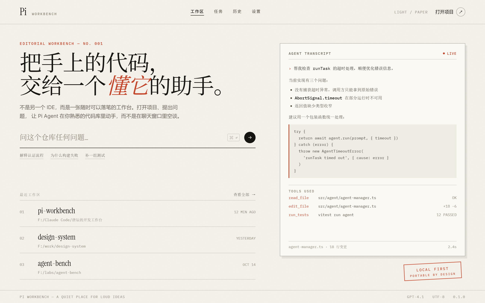
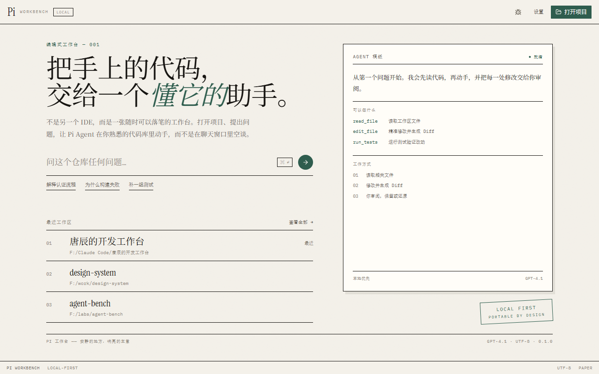
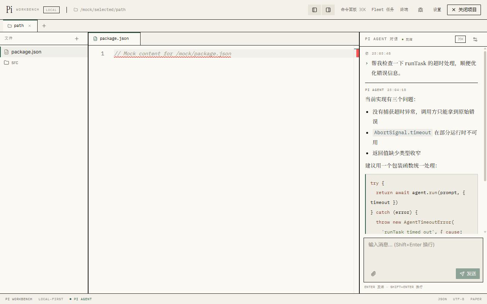
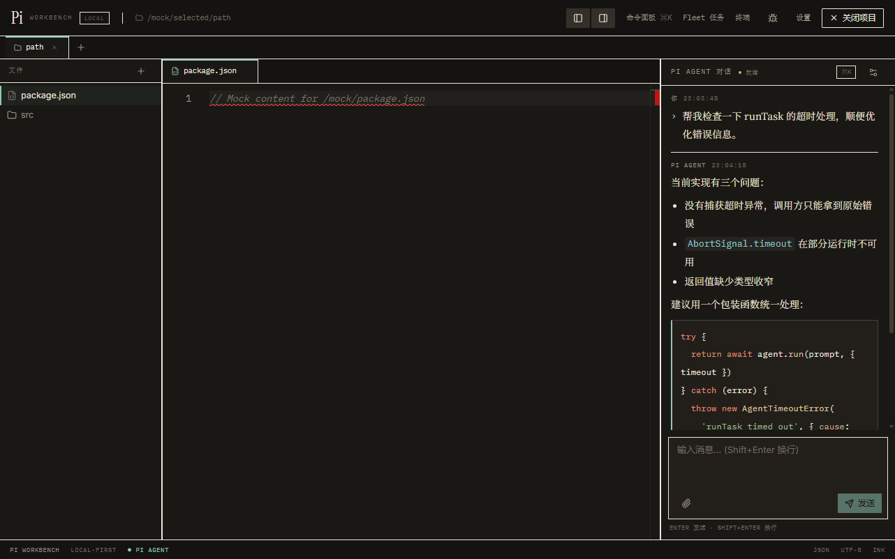
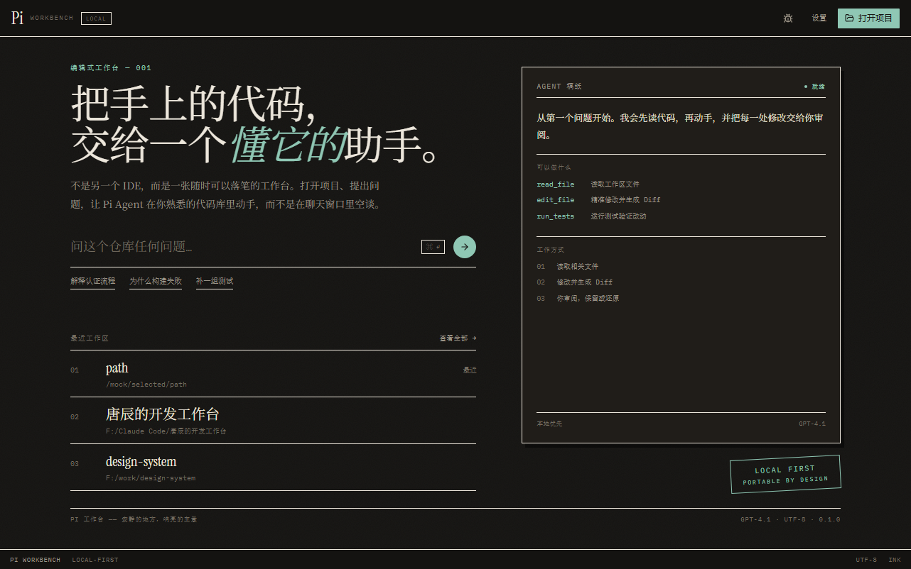

# Pi Workbench UI 方案：Paper & Ink

| 项目 | 内容 |
|---|---|
| 文档版本 | v1.3（历史方案与实施记录） |
| 日期 | 2026-10-20 |
| 状态 | 已实施；正式规范见 [DESIGN_SYSTEM.md](./DESIGN_SYSTEM.md) |
| 适用范围 | 渲染进程全部界面、Monaco / xterm 主题、应用主题设置 |
| 关联原型 | `docs/design/assets/paper-ink-welcome.png` |

---

## 1. 背景与目标

### 1.1 背景

当前界面已完成一轮 i18n 与 token 化改造，解决了深浅色混用、颜色硬编码的问题，但整体仍是"通用深色 IDE"的观感：近中灰底色、Tailwind 默认蓝、全大写微标签、面板仅靠 1px 灰线区分，缺少产品辨识度和设计感。

经过三轮方向对比（Linear 式、Raycast 式、VS Code 2026 式），最终确定采用 **Paper & Ink（纸墨/编辑式工作台）** 方向：

- 不追随通用 IDE 的深灰金属感，而是建立"纸面 + 墨线 + 松绿"的编辑排版语言；
- 首屏以编辑式欢迎页建立品牌感，工作区延续同一套纸墨体系；
- 保留三栏 IDE 骨架与全部功能，改动集中在视觉层与首屏信息架构。

### 1.2 目标

1. 建立一套完整、可执行的设计系统（颜色、字体、间距、组件、动效）。
2. 默认 Paper 浅色主题，同时提供完整的 Ink 深色主题。
3. 欢迎页承载品牌表达，工作区保证长时间编码的舒适度与可读性。
4. 全部字体本地打包，保持应用的便携式、离线可用特性。
5. 不改变现有功能边界、IPC 协议与数据结构。

### 1.3 非目标

- 不重构文件系统、Agent、Fleet、插件等业务逻辑。
- 不引入 Web 字体 CDN（必须离线可用）。
- 不增加新的账号、云同步或遥测。

---

## 2. 设计定位

**Paper & Ink —— 一张随时可以落笔的工作台。**

| 原则 | 含义 | 表现 |
|---|---|---|
| 纸 | 界面是纸面，不是面板堆叠 | 暖白底、纸卡、细墨线、错位硬阴影 |
| 墨 | 层级靠排版，不靠灰色深浅 | 近黑正文、衬线标题、等宽元数据、大留白 |
| 松绿 | 只有一个强调色 | 标题重音、链接、选中线、主按钮、印章；占比 <5% |

**禁止项**：渐变、玻璃拟态、柔光/发光、霓虹色、聊天气泡、彩色胶囊标签。

**参考气质**：印刷品、编辑排版、工程图纸；不是 macOS 原生工具，也不是 SaaS 仪表盘。

---

## 3. 基础系统

### 3.1 颜色 Tokens

颜色以语义 token 定义在 `src/index.css`，通过 `<html class="dark">` 在 Paper / Ink 之间切换。

| Token | Paper（默认） | Ink（深色） | 用途 |
|---|---|---|---|
| `--canvas` | `#F4F1EA` | `#141311` | 应用底色 |
| `--surface` | `#FBF9F4` | `#1A1815` | 面板、纸卡 |
| `--inset` | `#EFECE4` | `#221F1B` | 输入框、代码块 |
| `--ink` | `#171512` | `#EDE7DC` | 主文字 |
| `--ink-muted` | `#6D675C` | `#9C9487` | 次级文字 |
| `--ink-faint` | `#918A7D` | `#736C60` | 路径、时间等元数据 |
| `--rule` | `rgba(23,21,18,.16)` | `rgba(237,231,220,.14)` | 分隔线 |
| `--rule-strong` | `rgba(23,21,18,.32)` | `rgba(237,231,220,.28)` | 强调边框 |
| `--accent` | `#2F5D4E` | `#8FC7B4` | 强调、链接、选中、焦点、主按钮、印章 |
| `--accent-hover` | `#24493D` | `#A9D8C8` | 强调色 hover |
| `--success` | `#5E6B2E` | `#A8BF7A` | 成功、Diff 新增 |
| `--warning` | `#9A5B1F` | `#D6B26E` | 警告 |
| `--danger` | `#A83A22` | `#E06A4A` | 错误、删除 |
| `--teal` | `#3E5D66` | `#7FB6C4` | 类型、次要标识 |

**对比度实测**（WCAG）：

| 组合 | 对比度 | 结论 |
|---|---|---|
| ink / canvas | 16.15:1 | AAA |
| ink-muted / canvas | 4.97:1 | AA |
| ink-faint / canvas | 3.03:1 | 仅限元数据 |
| accent / canvas | 6.66:1 | AA |
| accent-fg / accent | 7.18:1 | AAA |
| success / canvas | 5.14:1 | AA |
| warning / canvas | 4.79:1 | AA |
| danger / canvas | 5.65:1 | AA |
| accent / Ink canvas | 9.72:1 | AAA |

### 3.2 字体

**全部通过 npm 本地打包，不使用 CDN。**

| 用途 | 字体 | 包 | 体积（解包） |
|---|---|---|---|
| 西文标题 / 项目名 | Instrument Serif | `@fontsource/instrument-serif` | 147 KB |
| 中文标题 / 项目名 | 思源宋体（Noto Serif SC Variable） | `@fontsource-variable/noto-serif-sc` | 6.4 MB |
| 界面正文 / 控件 | Inter Variable | `@fontsource-variable/inter` | 1.9 MB |
| 路径 / 时间 / 状态 / 代码标签 | IBM Plex Mono | `@fontsource/ibm-plex-mono` | 1.5 MB |

字体栈：

```css
--font-display: "Instrument Serif", "Noto Serif SC Variable", "Songti SC", "SimSun", serif;
--font-reading: "Noto Serif SC Variable", "Songti SC", "SimSun", serif;
--font-ui: "Inter Variable", "Inter", "PingFang SC", "Microsoft YaHei", system-ui, sans-serif;
--font-mono: "IBM Plex Mono", "Cascadia Code", Consolas, monospace;
```

**字号体系**：

| 角色 | 字号 / 行高 | 字体 | 用法 |
|---|---|---|---|
| Display | 56px / 1.04 | display | 欢迎页主标题 |
| H1 | 28px / 1.2 | display | 弹窗标题、空状态标题 |
| H2 | 20px / 1.3 | display | 分区标题、项目名 |
| Reading | 14px / 1.85 | reading | 欢迎页导语、Agent 回复、设置说明 |
| Body | 13px / 1.6 | ui | 控件、文件树、按钮 |
| Meta | 10.5px / 1.5，字距 0.14em，大写 | mono | 眉题、角色标签、状态 |
| Code | 12.5px / 1.65 | mono | 编辑器、代码块 |

> 衬线（思源宋体）用于 ≥18px 的标题、项目名，以及 14px 的阅读型正文；控件、路径与状态保持 Inter / mono，避免小字号宋体发虚。

### 3.3 间距、形状、阴影

- 间距基数 4px：4 / 8 / 12 / 16 / 24 / 32 / 48。
- 圆角：0–2px；只有圆形箭头按钮、头像使用全圆。
- 边框：1px `--rule`；强调用 `--rule-strong` 或松绿。
- 阴影：纸卡 `5px 6px 0 rgba(23,21,18,.08)`；Ink 模式 `5px 6px 0 rgba(0,0,0,.45)`。除此之外不使用柔和阴影。
- 背景纹理：可在欢迎页叠加极淡纸张噪点（SVG turbulence，透明度 ≤4%），工作区不使用。

### 3.4 动效与焦点

- 时长 140ms，`ease-out`；只做透明度、位移、下划线展开。
- 按钮按下位移 1px；不做缩放、不做发光。
- 焦点：1px 松绿描边 + 2px offset，保证键盘可见。
- 支持 `prefers-reduced-motion`，减少动效时直接切换状态。

---

## 4. 组件规范

### 4.1 按钮

| 类型 | 样式 |
|---|---|
| Primary | 松绿底 + 纸色字；hover 加深；按下位移 1px |
| Secondary | 透明底 + 1px rule；hover 纸面 inset |
| Ghost | 无边框；hover 出现下划线 |
| Danger | 朱砂文字 + 1px 朱砂边框；hover 6% 朱砂底 |

### 4.2 输入 / 选择

- 背景 `--inset`，1px `--rule`，圆角 2px；focus 时边框转松绿并加 2px offset。
- 欢迎页提问框为单行下划线样式（1px ink 底线），右侧圆形墨色发送按钮。
- 下拉框保留原生行为，样式改为纸面 + 墨线。

### 4.3 标签页

- 矩形，mono 11px；激活项纸面底 + 2px 松绿顶线，与编辑器连通。
- 未保存状态用 6px 松绿圆点；关闭按钮 hover 才显示（键盘 focus 时也显示）。

### 4.4 文件树

- 名称 Inter 13px，路径/元数据 mono 10.5px。
- 激活行：2px 松绿左边线 + `rgba(47,93,78,.06)` 底色，不使用整块高亮。
- 图标：lucide 线性图标，1.5px stroke，墨色 60% 透明度。

### 4.5 聊天（稿纸）

- 面板为纸面，消息区像一张稿纸：角色标签 mono 大写 + 时间；用户消息以 `›` 松绿起头，不加气泡。
- 助手正文使用思源宋体 14px / 1.85；列表、引用、表格使用项目符号与细线，不使用彩色块。
- 代码块：`--inset` 底 + 1px rule + 左侧 2px 松绿线；复制按钮为 mono 小标签。
- 工具调用以 mono 行展示：`read_file` / `edit_file` / `run_tests`，状态用墨色文字而非彩色胶囊。
- 流式光标为 1.5×14px 墨色方块。

### 4.6 编辑器（Monaco）

定义两个自定义主题：

**`pi-paper`**

| 元素 | 颜色 |
|---|---|
| 背景 | `#FBF9F4` |
| 行号 | `#B5AE9F` |
| 正文 | `#2B2721` |
| 关键词 | `#8A3B2A` |
| 字符串 | `#4F6B3A` |
| 类型 | `#3E5D66` |
| 函数 | `#6B4E2E` |
| 注释 | `#9A9284`（斜体） |
| 选中 | `rgba(47,93,78,.14)` |
| 当前行 | `rgba(23,21,18,.04)` |

**`pi-ink`**：背景 `#1A1815`，正文 `#E6DFD3`，关键词 `#E08A72`，字符串 `#9DBF8A`，类型 `#8FC4CF`，注释 `#7C7466`。

### 4.7 终端

- 浅色纸面终端（按已确认决策）：背景 `--surface`，正文 `--ink`，光标松绿。
- Ink 模式切换为深色纸面；字体 IBM Plex Mono 12.5px。
- 顶部工具条使用 mono 标签与文字按钮，不使用图标胶囊。

### 4.8 弹窗 / 命令面板 / Diff / Fleet / Toast

- 弹窗：纸卡 + 1px 墨线 + 错位硬阴影；标题用衬线；背景遮罩为 `rgba(23,21,18,.35)`，不做模糊。
- 命令面板：560px 纸片，mono 搜索，编号结果列表，选中项 2px 松绿左边线。
- Diff：纸面审阅单；新增行橄榄绿 8% 淡洗，删除行朱砂 8%；数量用印章式 mono 标签。
- Fleet：编号任务清单，状态用 mono 字（RUNNING / DONE / QUEUED），不使用彩色胶囊。
- Toast：纸片 + 左侧 2px 语义色线 + 错位阴影。

---

## 5. 页面与布局

### 5.1 欢迎页（已确认原型）



- 顶栏 64px：衬线字标 "Pi"、mono 副标、下划线导航、右侧"打开项目 ↗"。
- 主区双栏：左侧编辑式标题、说明、单行提问框、建议链接、编号最近工作区；右侧 Agent 稿纸卡片 + 印章。
- 内容最大宽 1180px，左右留白 52px。
- 提问框行为：没有工作区时点击先打开目录选择器；打开后把输入内容带入聊天输入框。
- 最近工作区使用真实数据；右侧卡片优先展示最近对话 / Fleet 任务，无数据时显示三条建议。

### 5.2 工作区

- 保留三栏结构：文件树 232px / 编辑器自适应 / 聊天 336px；可拖拽、可折叠。
- 顶栏 52px：字标、mono 路径、下划线操作入口；主操作墨色块。
- 标签栏 34px；状态栏 28px。
- 面板之间用 1px 墨线分隔，不做圆角卡片堆叠。
- 空状态使用衬线标题 + mono 说明 + 文本链接，不使用图标大圆。

### 5.3 设置

- 720px 纸片弹窗，左侧 180px 分节导航（通用 / API 配置 / 关于）。
- 分节标题衬线 20px，字段标签 mono 10.5px。
- 语言、主题（Paper / Ink / 跟随系统）、API 配置保持现有功能。

### 5.4 主题行为

- 默认：**Paper**。
- 设置中提供 Paper / Ink / 跟随系统，写入 `{appDir}/config/settings.json`。
- `electron/main.ts` 的默认设置改为 `theme: 'light'`；已保存的 `dark` 偏好继续生效，不强制覆盖。
- 主题切换同步：`<html class="dark">`、`<html lang>`、窗口标题、Monaco 主题、xterm 配色。

---

## 6. 技术实现

### 6.1 Token 结构

`src/index.css` 定义 RGB 三元组变量，`tailwind.config.js` 映射为语义颜色：

```css
:root {
  --canvas: 244 241 234;
  --surface: 251 249 244;
  --inset: 239 236 228;
  --ink: 23 21 18;
  --ink-muted: 109 103 92;
  --ink-faint: 145 138 125;
  --rule: 23 21 18;
  --accent: 47 93 78;
  --accent-hover: 36 73 61;
  --accent-fg: 251 249 244;
  --success: 94 107 46;
  --warning: 154 91 31;
  --danger: 168 58 34;
}
html.dark { /* Ink 值 */ }
```

Tailwind：

```js
colors: {
  canvas: 'rgb(var(--canvas) / <alpha-value>)',
  surface: 'rgb(var(--surface) / <alpha-value>)',
  inset: 'rgb(var(--inset) / <alpha-value>)',
  ink: { DEFAULT: '...', muted: '...', faint: '...' },
  rule: '...',
  accent: { DEFAULT: '...', hover: '...', fg: '...' },
  success: '...', warning: '...', danger: '...', teal: '...',
},
fontFamily: { display: [...], sans: [...], mono: [...] },
borderRadius: { DEFAULT: '2px', none: '0' },
boxShadow: { print: '5px 6px 0 rgb(23 21 18 / 0.08)' },
```

### 6.2 字体加载

- 在 `src/main.tsx` 顶部引入四个字体的 CSS；
- 思源宋体只引入 `chinese-simplified` 子集，`font-display: swap`；
- 字体文件随构建产物输出，Electron 离线可用；
- 首屏渲染不依赖网络。

### 6.3 组件改造清单

| 文件 | 工作 |
|---|---|
| `tailwind.config.js` | 新颜色、字体、圆角、阴影 token |
| `src/index.css` | 主题变量、基础样式、Markdown 纸墨排版、焦点/滚动条 |
| `src/store/themeStore.ts` | 默认 `light`；Ink 解析保持现有逻辑 |
| `electron/main.ts` | `DEFAULT_SETTINGS.theme = 'light'` |
| `src/components/ui.tsx` | 重写 Button / IconButton / Input / Textarea / Select / Field / EmptyState / Modal / Spinner |
| `src/App.tsx` | 欢迎页、顶栏、三栏、状态栏、主题接入 |
| 新增 `src/components/WelcomeScreen.tsx` | 编辑式欢迎页与真实数据接入 |
| `src/components/ChatPanel.tsx` | 稿纸式聊天、Markdown、工具调用行、代码复制 |
| `src/components/FileExplorer.tsx` | 墨线文件树、松绿激活线、mono 路径 |
| `src/components/MonacoEditor.tsx` | `pi-paper` / `pi-ink` 主题、标签页样式 |
| `src/components/TerminalPanel.tsx` | 浅色纸面终端、xterm 主题 |
| `src/components/Settings.tsx` | 纸片弹窗、分节导航、下划线输入 |
| `src/components/CommandPalette.tsx` | 纸片命令面板、编号列表 |
| `src/components/DiffViewer.tsx` | 纸面 Diff、印章式统计 |
| `src/components/FleetPanel.tsx` | 编号任务清单、mono 状态 |
| `src/components/Toast.tsx` | 纸片 Toast |
| `src/components/ErrorBoundary.tsx` | 纸面错误页 |
| `src/components/IPCDebug.tsx` | 纸面调试面板 |
| `src/i18n/translations.ts` | 欢迎页新文案（中英） |
| `AGENTS.md` | 更新 UI/UX 规范为 Paper & Ink token |

### 6.4 可访问性

- 正文与链接对比度 ≥4.5:1（已实测）。
- `faint` 仅用于时间、路径等非关键元数据。
- 所有图标按钮保留 `aria-label` 与可见焦点。
- 支持 200% 缩放；三栏可折叠，窄窗口不产生横向溢出。
- 尊重 `prefers-reduced-motion`。

### 6.5 测试与构建

- 现有 144 个测试保持通过；新增欢迎页提问→目录选择→聊天草稿的行为测试。
- `npm run type-check`、`npm run lint`、`npm test`、`npm run build` 全部通过。
- 完成后 grep 校验：`gray-*`、`blue-*`、`dark:` 变体在组件中为 0（背景/文字全部走 token）。

---

## 7. 执行方案（WBS）

### 7.1 执行原则

1. **每阶段结束时应用必须可运行**：能启动、能打开工作区、能聊天、测试通过；不允许出现"改到一半不能跑"的中间态提交。
2. **先原型、后代码**：阶段 0 只产出静态图，确认观感后才动项目代码。
3. **先基础层、后页面**：token、字体、组件、编辑器主题先落地，页面只做组合，避免页面里再出现一次性样式。
4. **只改表现层**：不改 IPC 协议、Agent 行为、存储结构；除主题默认值与欢迎页草稿传递外，不改业务逻辑。
5. **每阶段一个提交**：提交粒度按阶段，便于审查与回滚；不把换肤、页面重排、功能修改混在一个提交里。
6. **截图作为验收物**：每个阶段结束提供 Paper / Ink 两张 2560×1600 截图，作为进入下一阶段的门槛。

### 7.2 分支、提交与回滚

- 从 `main` 切出分支：`feat/paper-ink-ui`。
- 提交序列：

| 顺序 | 提交信息 | 内容 |
|---|---|---|
| 1 | `docs(design): Add Paper & Ink design and execution plan` | 本文档与原型截图 |
| 2 | `feat(ui): Add Paper & Ink tokens, fonts and editor themes` | 阶段 1 |
| 3 | `feat(ui): Rebuild welcome screen in editorial style` | 阶段 2 |
| 4 | `feat(ui): Apply Paper & Ink to workspace and chat` | 阶段 3 |
| 5 | `feat(ui): Restyle overlays and auxiliary surfaces` | 阶段 4 |
| 6 | `test(ui): Verify Paper & Ink across themes and sizes` | 阶段 5（含修复） |

- 合并方式：每阶段完成并确认后，可继续在同一分支提交；最终以 `--no-ff` 合入 `main`。
- 回滚：任一阶段出问题，按提交 revert 即可回到上一个可运行状态；主题偏好可随时在设置中切回 Ink 验证。
- 不引入运行时 feature flag；以分支和阶段提交控制风险。

### 7.3 阶段 0：工作区视觉原型（4h）

| # | 任务 | 具体内容 | 产出 |
|---|---|---|---|
| 0.1 | 搭建工作区原型 | 复用欢迎页的 token 与字体，制作"文件树 + 编辑器 + 聊天空状态 + 终端"四区布局 | 临时原型（已完成并清理） |
| 0.2 | 出图 | 用 headless Chrome 以 2 倍像素导出 2560×1600 PNG | 截图（最终见 `docs/design/assets/`） |
| 0.3 | 评审清单 | 层级是否清楚；浅色代码是否可读；聊天稿纸是否成立；标签/状态栏是否协调 | 评审结论 |

**门槛**：确认工作区观感后才进入阶段 1。本阶段不修改项目源码。

### 7.4 阶段 1：基础层（12h）

| # | 任务 | 具体改动 | 文件 | 验证 | 工时 |
|---|---|---|---|---|---|
| 1.1 | 字体安装与引入 | 安装 4 个字体包；在入口引入 400/500 与中文子集；确认字体族名称；移除任何 CDN 引用 | `package.json`、`src/main.tsx` | 断网启动字体正常；构建产物含字体 | 1h |
| 1.2 | 颜色与基础样式 | 用 Paper / Ink 变量替换旧 token；新增 `::selection`、滚动条、焦点、纸张纹理工具类、Markdown 纸墨排版 | `src/index.css` | 两套主题底色/文字正确；对比度脚本通过 | 3h |
| 1.3 | Tailwind 映射 | 颜色、字体族、圆角、`shadow-print`；删除旧 `primary/secondary/dark` 与多余扩展 | `tailwind.config.js` | 任意 token 类可编译 | 1h |
| 1.4 | 默认主题与持久化 | `themeStore` 默认 `light`；主进程 `DEFAULT_SETTINGS.theme = 'light'`；已保存偏好优先 | `src/store/themeStore.ts`、`electron/main.ts` | 重启后主题保持；旧 `dark` 配置不被覆盖 | 1h |
| 1.5 | 基础组件重写 | Button / IconButton / Input / Textarea / Select / Field / EmptyState / Modal / Spinner 的纸墨样式；统一尺寸与状态；保持 props 兼容 | `src/components/ui.tsx` 及调用处 | 现有界面无类型错误；按钮/输入/弹窗可用 | 3h |
| 1.6 | Monaco 双主题 | `defineTheme('pi-paper')` / `defineTheme('pi-ink')`；按主题切换；标签栏同步纸墨样式 | `src/components/MonacoEditor.tsx` | 编辑器随主题切换；代码可读 | 1.5h |
| 1.7 | xterm 双主题 | 纸面/墨面终端配色、光标、字体 | `src/components/TerminalPanel.tsx` | 终端随主题切换 | 0.5h |
| 1.8 | 阶段验收 | 类型检查、lint、测试；双主题截图；grep 检查旧色类 | — | 全部通过 | 1h |

**交付物**：可运行的换肤版本；Paper / Ink 两张截图；基础组件清单确认。

### 7.5 阶段 2：欢迎页（8h）

| # | 任务 | 具体改动 | 文件 | 验证 | 工时 |
|---|---|---|---|---|---|
| 2.1 | 新增欢迎页组件 | 从 `App.tsx` 抽出欢迎区，按原型实现眉题、衬线标题、说明、提问框、建议链接、编号最近项目、Agent 纸卡与印章 | 新增 `src/components/WelcomeScreen.tsx`、`src/App.tsx` | 与原型布局一致 | 2.5h |
| 2.2 | 文案与 i18n | 新增中英文案 key：眉题、标题、说明、提问占位、建议、最近项目、Agent 卡片、印章 | `src/i18n/translations.ts` | 中英文切换无缺字 | 1h |
| 2.3 | 真实数据接入 | 最近工作区来自 `workspaceStore`；右侧卡片优先展示最近对话/Fleet 任务，无数据时显示建议 | `WelcomeScreen.tsx` | 数据为空/有数据均正常 | 2h |
| 2.4 | 提问→选目录→带入聊天 | 无工作区时点击提问打开目录选择器；打开后写入聊天草稿；有工作区时直接聚焦聊天输入 | `WelcomeScreen.tsx`、`chatStore.ts`、`ChatPanel.tsx` | 选择目录后草稿出现在聊天输入框 | 1.5h |
| 2.5 | 测试 | 欢迎页渲染、提问触发目录选择、草稿传递 | `tests/renderer-components.test.tsx` 或新增测试 | 测试通过 | 1h |

**交付物**：可交互的欢迎页；中英文截图；新增测试。

### 7.6 阶段 3：工作区（15h）

| # | 任务 | 具体改动 | 文件 | 验证 | 工时 |
|---|---|---|---|---|---|
| 3.1 | 应用外壳 | 顶栏 52px、字标/路径/文字操作入口、主操作墨色按钮；标签栏 34px、状态栏 28px；保留拖拽与折叠 | `src/App.tsx` | 三栏可拖拽/折叠 | 2.5h |
| 3.2 | 文件树 | 墨线行、松绿激活线、mono 路径、线性图标；右键菜单/新建弹窗同步样式 | `FileExplorer.tsx` | 选中与右键操作正常 | 3h |
| 3.3 | 编辑器标签 | 矩形标签、mono 字号、激活松绿顶线、脏标记与关闭按钮 | `MonacoEditor.tsx` | 切换/关闭/脏标记正常 | 2h |
| 3.4 | 聊天稿纸 | 角色标签、用户 `›` 样式、助手宋体正文、代码块松绿线、工具调用行、错误/加载态 | `ChatPanel.tsx` | Markdown/复制/流式正常 | 4h |
| 3.5 | 终端 | 纸面终端工具条与 xterm 主题核对 | `TerminalPanel.tsx` | 输出/重启/发送到聊天正常 | 1.5h |
| 3.6 | 状态栏与响应 | 状态栏内容排版；1024/1280/1440 宽度检查；折叠状态检查 | `App.tsx` | 无横向溢出 | 1h |
| 3.7 | 测试与截图 | 类型/lint/测试；三栏双主题截图 | — | 通过 | 1h |

**交付物**：完整工作区；Paper / Ink 截图；交互回归结论。

### 7.7 阶段 4：浮层与辅助界面（11h）

| # | 任务 | 具体改动 | 文件 | 验证 | 工时 |
|---|---|---|---|---|---|
| 4.1 | 设置 | 纸片弹窗、左侧分节导航、下划线字段、主题选择 | `Settings.tsx` | 语言/主题/API 配置可用 | 3h |
| 4.2 | 命令面板 | 纸片、mono 搜索、编号结果、松绿选中线 | `CommandPalette.tsx` | 搜索/执行/插件开关正常 | 2h |
| 4.3 | Diff 审阅 | 纸面 Diff、橄榄/朱砂淡洗、印章式统计、保留/还原按钮 | `DiffViewer.tsx` | 审阅与还原流程正常 | 2h |
| 4.4 | Fleet | 编号任务清单、mono 状态、日志纸面 | `FleetPanel.tsx` | 创建/取消/清理正常 | 2h |
| 4.5 | Toast / 错误 / IPC | 纸片 Toast、错误边界、调试面板 | `Toast.tsx`、`ErrorBoundary.tsx`、`IPCDebug.tsx` | 提示与错误态正常 | 1h |
| 4.6 | 阶段验收 | 双主题截图；类型/lint/测试 | — | 通过 | 1h |

**交付物**：全部浮层统一为纸墨语言；截图；回归结论。

### 7.8 阶段 5：质量验证（5h）

| # | 检查项 | 方法 | 通过标准 |
|---|---|---|---|
| 5.1 | 主题矩阵 | 8 个界面 × Paper / Ink | 无视觉断裂、无不可读文字 |
| 5.2 | 对比度 | Node 脚本计算所有前景/背景组合 | 正文、链接 ≥4.5:1 |
| 5.3 | 键盘与焦点 | Tab 走查全部交互控件 | 焦点可见，图标按钮有名称 |
| 5.4 | 缩放与宽度 | 200% 缩放；1024 / 1280 / 1440 宽度 | 无横向溢出，面板可用 |
| 5.5 | 动效降级 | 开启 `prefers-reduced-motion` | 无位移动画，功能不受影响 |
| 5.6 | 中英文 | 两种语言各走查一次 | 无截断、无缺译 |
| 5.7 | 代码质量 | `type-check`、`lint`、`test`、`build` | 全部通过 |
| 5.8 | 样式残留 | grep `gray-*`、`blue-*`、`dark:` | 组件中为 0（文档、注释除外） |

**交付物**：最终双主题截图集、验证记录、可合并状态。

### 7.9 依赖关系与里程碑

```
阶段 0（原型确认）
   └─> 阶段 1（tokens / 字体 / 组件 / 编辑器主题）
          ├─> 阶段 2（欢迎页）──┐
          └─> 阶段 3（工作区）──┴─> 阶段 4（浮层）─> 阶段 5（QA）
```

| 里程碑 | 完成标志 | 评审点 |
|---|---|---|
| M0 | 工作区原型截图确认 | 观感确认后进入 M1 |
| M1 | 应用完成换肤，基础组件统一 | 双主题截图确认 |
| M2 | 欢迎页可交互 | 中英文截图确认 |
| M3 | 工作区完成 | 三栏交互 + 双主题截图 |
| M4 | 全部浮层完成 | 全界面截图 |
| M5 | QA 通过 | 合并 `main` |

### 7.10 验证命令与 Definition of Done

每个阶段结束执行：

```bash
npm run type-check
npm run lint
npm test
```

阶段 5 额外执行：

```bash
npm run build:renderer
```

样式残留检查（预期无匹配）：

```bash
grep -rnE "text-gray-|bg-gray-|border-gray-|dark:" src/components src/App.tsx
```

**Definition of Done**：

1. Paper / Ink 两套主题下，欢迎页、工作区、聊天、设置、命令面板、Diff、Fleet 均无视觉断裂。
2. 字体全部本地加载，断网可用；中文标题使用思源宋体。
3. 所有正文与链接对比度 ≥4.5:1；`faint` 仅用于元数据。
4. 键盘焦点可见；图标按钮具备 `aria-label`；支持 200% 缩放与 reduced motion。
5. 现有 144 个测试与新增测试全部通过；类型检查、lint、生产构建通过。
6. 组件内无遗留 gray/blue 调色板类与 `dark:` 变体。
7. 欢迎页提问→选目录→带入聊天的流程可用。
8. `AGENTS.md` 的 UI/UX 规范已更新为 Paper & Ink token。

**总工时约 55 人时（≈7 个工作日），不含评审等待。**

---

## 8. 风险与对策

| 风险 | 影响 | 对策 |
|---|---|---|
| 思源宋体体积较大 | 安装包增加约 6–8 MB | 只引入中文简体子集；其余字体使用子集/可变版 |
| 小字号宋体发虚 | 可读性下降 | 衬线只用于标题与 14px 阅读正文；控件保持 Inter |
| 浅色代码主题对比不足 | 长时间编码疲劳 | Monaco 主题逐色校验；提供 Ink 深色模式 |
| 主题默认从 dark 改为 light | 老用户观感变化 | 已保存偏好继续生效；仅新用户默认 Paper |
| 纸墨风格弱化状态色 | 状态不易辨识 | 状态同时使用 mono 文案 + 细线/印章，不只依赖颜色 |
| 绿色主色与成功色混淆 | 状态辨识度下降 | 主色用冷松绿、成功用暖橄榄；状态始终配 mono 文案与图标，不只依赖颜色 |
| 一次性全量改版 | 返工风险 | 阶段 0 先出工作区原型，分阶段截图确认 |

---

## 9. 决策记录

| 编号 | 决策 | 结论 |
|---|---|---|
| D1 | 默认主题 | Paper 浅色为默认，同时提供完整 Ink 深色模式与跟随系统 |
| D2 | 中文字体 | 打包思源宋体（`@fontsource-variable/noto-serif-sc`），不依赖系统字体 |
| D3 | 欢迎页提问行为 | 无工作区时先打开项目选择器，输入内容带入聊天 |
| D4 | 终端配色 | 浅色纸面终端，与整体主题一致 |
| D5 | 实施方式 | 先做工作区静态原型确认，再按阶段落地 |
| D6 | 主强调色 | 采用 G1 松墨绿：主按钮、印章、标题重音全部跟随绿色 |
| D7 | 语义分离 | 成功与 Diff 新增使用暖橄榄；朱砂仅保留为错误/删除色 |

---

## 10. 实施结果（2026-10-20）

阶段 1–5 已全部实施并通过验收。

### 10.1 实际界面

**Paper 欢迎页**



**Paper 工作区**



**Ink 工作区**



**Ink 欢迎页**



### 10.2 实施范围

- 设计 token、字体、主题切换、Monaco / xterm 双主题全部落地。
- 欢迎页、工作区（文件树 / 标签 / 编辑器 / 稿纸聊天 / 浅色终端 / 状态栏）完成 Paper & Ink 改造。
- 设置、命令面板、Diff、Fleet、Toast、错误边界、IPC 调试统一为纸墨语言。
- 欢迎页提问→选目录→带入聊天的流程可用。
- `AGENTS.md` 的 UI/UX 规范已同步为 Paper & Ink。

### 10.3 验证记录

| 项目 | 结果 |
|---|---|
| `npm run type-check` | 通过 |
| `npm run lint` | 通过 |
| `npm test` | 20 个文件 / 189 个用例通过 |
| `npm run build:renderer` / `build:main` | 通过 |
| 旧调色板类与 `dark:` 变体 | 0 处 |
| 1024 / 1440 宽度 | 无横向溢出 |
| 字体 | Instrument Serif、Noto Serif SC、Inter、IBM Plex Mono 本地加载 |

### 10.4 实施说明

- 组件沿用既有语义 token 名称（`surface` / `panel` / `ink` / `accent` 等），值映射为 Paper & Ink 色板；新增松墨绿 `accent`，朱砂仅保留为 `danger`。
- 思源宋体用于标题与 14px 阅读型正文（欢迎页导语、Agent 回复、设置说明）；操作界面保持 Inter，避免小字号发虚。
- 字体产物共 121 个 woff2 子集，构建资源约 22 MB（含 Monaco worker）。
- Markdown 相关依赖单独分包，主业务 chunk 约 441 kB（gzip 117 kB）。

---

## 11. 附录

### 10.1 原型与截图

- 选定方向原型为临时文件，阶段结束后已清理；最终视觉见 `docs/design/assets/`。
- 高清截图：`docs/design/assets/paper-ink-welcome.png`（2560×1600）

### 10.2 字体引入示例

```ts
// src/main.tsx
import '@fontsource/instrument-serif/400.css'
import '@fontsource/instrument-serif/400-italic.css'
import '@fontsource-variable/noto-serif-sc'
import '@fontsource-variable/inter'
import '@fontsource/ibm-plex-mono/400.css'
import '@fontsource/ibm-plex-mono/500.css'
```

### 10.3 相关文档

- [项目进度](../progress/STATUS.md)
- [项目结构](../architecture/PROJECT_STRUCTURE.md)
- [AI 开发指南](../../AGENTS.md)
